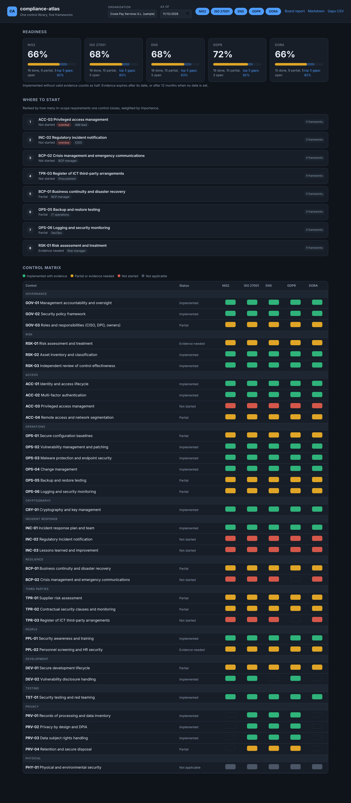
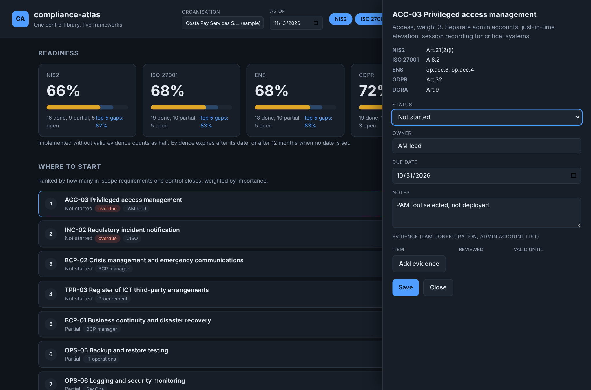
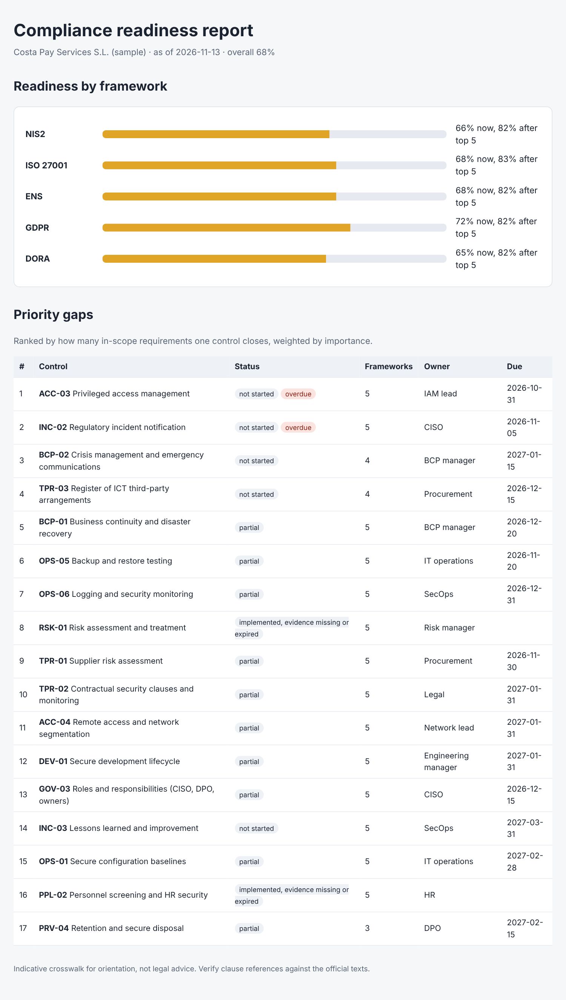

# compliance-atlas

One control library mapped to **NIS2, ISO/IEC 27001:2022, ENS (RD 311/2022), GDPR and DORA**, with an evidence-aware readiness score and a ranked list of the controls that close the most requirements at once.

> Built with AI assistance (Claude) as a portfolio project. The clause mapping is an indicative crosswalk for orientation, not legal advice: verify it against the official texts.



## Why

Teams that answer to several frameworks usually track each one in its own spreadsheet and do the same work twice. Most requirements overlap. This tool keeps **35 common controls** and maps each one to the clauses it helps satisfy, so one piece of evidence counts everywhere, and the question "what should we do first?" has an answer: the control that closes the most in-scope requirements, weighted by importance.

## Quick start

Requires Java 17+ (no Maven, Gradle or other dependencies).

```bash
./build.sh test                                   # javac + built-in test runner, 17 tests
java -cp out/main dev.jvch.atlas.Main serve samples/costa-pay.json   # web UI on http://127.0.0.1:8500
```

```bash
java -cp out/main dev.jvch.atlas.Main gaps   samples/costa-pay.json          # ranked gaps in the terminal
java -cp out/main dev.jvch.atlas.Main report samples/costa-pay.json --format html > report.html
java -cp out/main dev.jvch.atlas.Main report samples/costa-pay.json --format md|csv|json
java -cp out/main dev.jvch.atlas.Main check  samples/costa-pay.json --min 70  # exit code 2 if any framework is below 70%
java -cp out/main dev.jvch.atlas.Main catalog --framework ens                 # list controls and clause references
```

`check` works as a CI gate for a compliance-as-code repository: keep the assessment JSON in git and fail the pipeline when readiness drops.

## How the score works

* Each control has a **weight** (1 to 3) and maps to one or more clauses per framework.
* **Implemented with valid evidence** scores 1.0. **Implemented without evidence, or with expired evidence, scores 0.5** and is flagged "evidence needed". Evidence is valid until its date, or for 12 months after review when no date is set.
* **Partial** scores 0.5, **not started** 0. **Not applicable** controls leave the denominator.
* **Readiness** of a framework is the weighted mean over the controls that map to it.
* **Leverage** of a gap is `weight x in-scope frameworks it satisfies x distance to full`. The board report also shows what each framework would reach if the top 5 gaps were closed.



The board report is a standalone HTML page (no scripts) that can be saved as PDF:



## Assessment file

```json
{
  "organisation": "Costa Pay Services S.L.",
  "asOf": "2026-11-13",
  "scope": ["nis2", "iso27001", "ens", "gdpr", "dora"],
  "controls": {
    "ACC-02": {
      "status": "implemented",
      "owner": "IAM lead",
      "due": null,
      "notes": "",
      "evidence": [{ "title": "Conditional access export", "reviewed": "2026-10-02", "validUntil": null }]
    }
  }
}
```

Statuses: `not_started`, `partial`, `implemented`, `not_applicable`. Inputs are validated (unknown controls, statuses and frameworks are rejected; strings and evidence lists are size-capped).

## Security design

The UI is local, so it is built like something you would be comfortable running next to sensitive evidence notes:

* Binds to **127.0.0.1 only**; requests whose `Host` header is not the loopback address are refused (DNS rebinding).
* Writes require a custom `X-Atlas-Request` header and `application/json`, and refuse a foreign `Origin` (CSRF).
* Strict CSP on the app (`script-src 'self'`, no inline script or style); the generated report has no script at all.
* All UI rendering uses `textContent`; a test fails the build if `innerHTML`, inline handlers or remote URLs appear.
* Request bodies are size-limited; JSON parsing is strict with a nesting limit; CSV export neutralises spreadsheet formula injection; HTML output is escaped.
* Edits are written atomically to the assessment file. No cookies, no telemetry, no network calls.

## Layout

```
src/main/java/dev/jvch/atlas/   Json, Catalog, Assessment, Scoring, Reports, Server, Main
src/main/resources/data/        controls.psv (the crosswalk, plain text, easy to review and extend)
src/main/resources/public/      index.html, style.css, app.js
samples/costa-pay.json          fictional fintech assessment
src/test/java/.../AllTests.java dependency-free test runner
```

## Extending the catalog

Add a line to `controls.psv`: `id|domain|title|weight|summary|evidence hint|NIS2|ISO27001|ENS|GDPR|DORA`, with clause references separated by `;`. The loader rejects malformed rows and duplicate ids.

## Scope and limits

This is an organisation-level readiness view, not an audit: it does not evaluate evidence quality, does not cover sector-specific rules (for example national NIS2 transpositions) and the mapping is deliberately coarse. Use it to plan and communicate; use the official texts and your auditor to certify.

MIT licensed.
